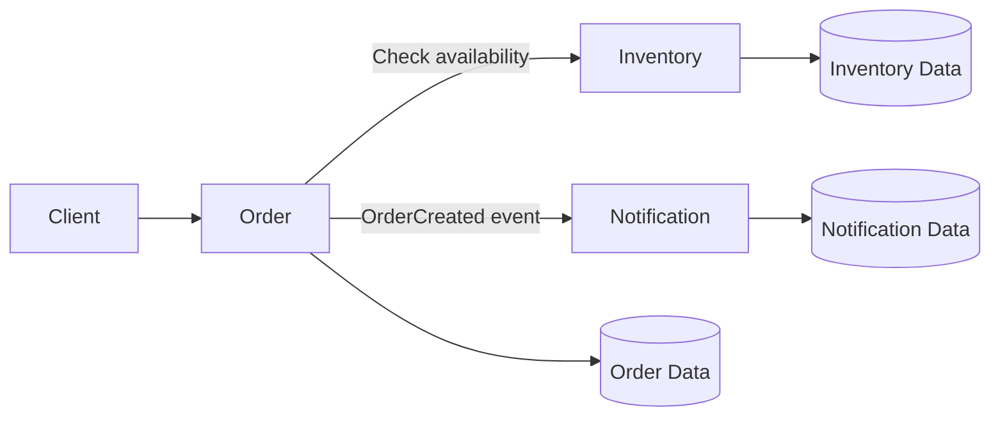

# Online Store Distributed Application

## Overview

This project implements a small distributed online-store application using Python and REST communication.

The system contains three logical services:

- Order Service
- Inventory Service
- Notification Service

The Order Service and Inventory Service run as independent processes. When an order is submitted, the Order Service checks item availability through the Inventory Service before creating the order.

## Architecture



## Service Responsibilities

### Order Service

The Order Service accepts orders, validates requests, checks inventory availability, creates orders, and tracks their status.

It also handles failures when the Inventory Service does not respond.

### Inventory Service

The Inventory Service owns the sample inventory data and checks whether an item and requested quantity are available.

### Notification Service

The Notification Service represents sending a notification after an order is created. It is included in the architecture design but is not implemented because the assignment only requires the Order-to-Inventory interaction.

## Data Ownership

| Service | Data Owned |
|---|---|
| Order Service | Order ID, item ID, quantity, and order status |
| Inventory Service | Item IDs and available quantities |
| Notification Service | Notification records and delivery status |

Each service owns and controls its own data. Services do not directly modify another service's data.

## Service Boundaries

The services are separated according to their business responsibilities. The Order Service manages orders, while the Inventory Service manages item availability. This separation prevents both services from directly modifying the same data and allows them to run independently.

The Notification Service is separate because sending notifications is different from creating orders or managing inventory. Clear boundaries also help isolate failures when one service becomes unavailable.

## Command, Query, and Event Classification

| Interaction | Type | Explanation |
|---|---|---|
| Check whether an item is available | Query | It reads inventory information without changing inventory data. |
| Create an order | Command | It changes the system by creating a new order. |
| Order was created | Event | It announces that an order has already been created. |

## Project Structure

```text
online-store-services/
├── order_service.py
├── inventory_service.py
├── requirements.txt
├── README.md
├── .gitignore
evidence/
├── Screenshot 2026-10-10 233159.png
└── Screenshot 2026-10-10 234556.png
```

## Technologies Used

- Python
- Flask
- Requests
- REST
- JSON
- PowerShell on Windows

## Installation

Open PowerShell in the project directory.

Create a virtual environment:

```powershell
py -m venv .venv
```

Activate the virtual environment:

```powershell
.venv\Scripts\Activate.ps1
```

Install the dependencies:

```powershell
py -m pip install -r requirements.txt
```

The `requirements.txt` file contains:

```text
Flask
requests
```

## Running the Services

Open two separate terminals.

### Terminal 1: Start the Inventory Service

```powershell
.venv\Scripts\Activate.ps1
py inventory_service.py
```

The Inventory Service runs on port `5001`.

### Terminal 2: Start the Order Service

```powershell
.venv\Scripts\Activate.ps1
py order_service.py
```

The Order Service runs on port `5000`.

Both services run as independent processes.

## Successful Request

The following request submits an order for one laptop:

```powershell
$response = Invoke-RestMethod `
  -Uri http://localhost:5000/orders `
  -Method Post `
  -ContentType "application/json" `
  -Body '{"item_id":"laptop","quantity":1}'

$response | ConvertTo-Json -Depth 5
```

Example response:

```json
{
  "message": "Order created",
  "order": {
    "item_id": "laptop",
    "order_id": "cd4ae841-c5e3-486a-a86f-7ee5188b3ac5",
    "quantity": 1,
    "status": "created"
  }
}
```

The order ID is generated dynamically and may be different for each request.


## Inventory Service Failure Test

The Inventory Service was stopped while the Order Service continued running.

The Inventory Service was checked using:

```powershell
Get-NetTCPConnection -LocalPort 5001 -State Listen
```

No matching connection was found, confirming that no process was listening on port `5001`.

The following request was then sent to the Order Service:

```powershell
try {
    Invoke-RestMethod `
      -Uri http://localhost:5000/orders `
      -Method Post `
      -ContentType "application/json" `
      -Body '{"item_id":"laptop","quantity":1}'
}
catch {
    $_.ErrorDetails.Message
}
```

The Order Service returned the following error:

```json
{
  "error": "Inventory Service request timed out"
}
```

This demonstrates that the Order Service handled the Inventory Service dependency failure and remained running instead of crashing.


## Timeout Handling

The Order Service uses a timeout when calling the Inventory Service:

```python
INVENTORY_TIMEOUT_SECONDS = 2
```

If the Inventory Service does not respond within the configured time, the Order Service returns an error instead of crashing.

## HTTP Responses

| Situation | HTTP Status |
|---|---:|
| Successful order creation | 201 Created |
| Invalid request | 400 Bad Request |
| Item unavailable | 409 Conflict |
| Inventory Service timeout | 504 Gateway Timeout |

## Reflection

Clear service boundaries make it easier to understand which service is responsible for each business function. Data ownership prevents multiple services from directly modifying the same data, reducing inconsistency and coordination problems. Independent services can be developed, deployed, and scaled without tightly coupling the entire application. These boundaries also make failures easier to isolate because one service can handle a dependency failure without crashing the entire application.
